# Introdução

Este repositório contém a documentação e as evidências da atividade prática de Testes de Caixa Cinza em APIs de autenticação. O foco do projeto é validar o fluxo de login, o tratamento de erros e a segurança, utilizando o Supabase como provedor de autenticação (BaaS) e o Postman Desktop como ferramenta de execução e validação das requisições HTTP.

# Objetivo da Atividade

O objetivo principal é compreender e aplicar testes de caixa cinza em uma API real. Para isso, foram realizadas as configurações do ambiente no Supabase, a criação de um usuário de teste, a estruturação de requisições HTTP (headers e body) no Postman e a validação das respostas (status HTTP, mensagens JSON e tokens). Toda a documentação técnica foi registrada neste README.

# Configuração do Supabase

Para a criação do ambiente de autenticação, foi criado um projeto na plataforma Supabase. A autenticação escolhida foi a padrão por E-mail e Senha. Um usuário de teste foi criado e confirmado manualmente no painel (*Authentication > Users*) para permitir a realização dos testes de login imediatos.

As credenciais obtidas para a integração foram:

- **API URL (Project URL):** `https://xvhiaxrlyuqimgtxzufb.supabase.co`
- **API KEY (Publishable key):** `sb_publishable_BjrYlv_msrfyDH2CEWxuWg_9ULhVQB4`

**Evidências:**

*Painel do projeto:*

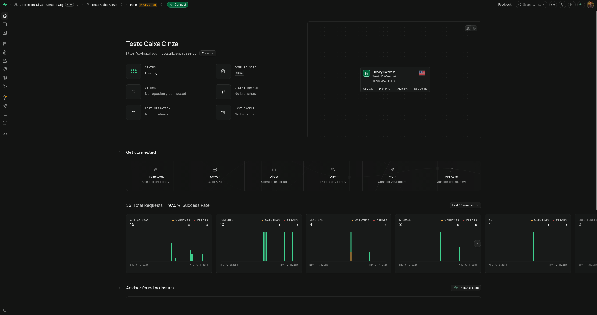

*Credenciais da API (API Keys):*

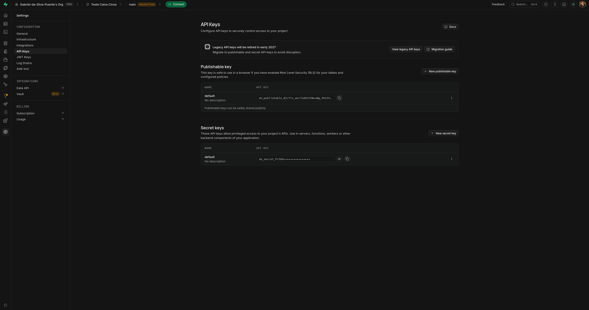

*Usuário criado e autenticação habilitada:*

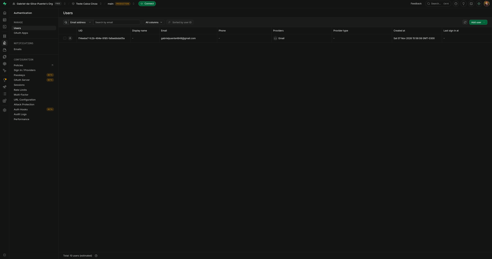

# Configuração do Postman

No Postman Desktop, foi criado um Workspace chamado "Workspace Testes" e um Environment específico para o projeto. O Environment foi configurado com as variáveis necessárias para dinamizar as requisições, evitando a exposição de dados fixos (hardcoded) e facilitando a troca de ambiente.

As variáveis configuradas foram:

- `base_url`: URL raiz do projeto Supabase.
- `api_key`: A chave pública do projeto.
- `email`: E-mail do usuário de teste.
- `password`: Senha do usuário de teste.

**Evidências:**

*Workspace e Environment configurado com as variáveis:*

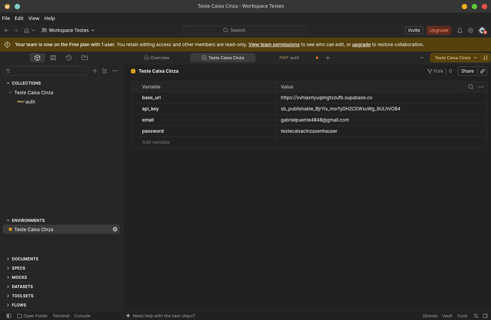

# Configuração das Requisições

A requisição para testar o login foi estruturada da seguinte forma:

- **Endpoint:** `{{base_url}}/auth/v1/token?grant_type=password`
- **Método HTTP:** POST
- **Headers:**
  - `apikey`: `{{api_key}}`
  - `Content-Type`: `application/json`
- **Body (JSON):**

```json
{
  "email": "{{email}}",
  "password": "{{password}}"
}
```

A finalidade desta requisição é enviar as credenciais do usuário para o endpoint de autenticação do Supabase e, em caso de sucesso, receber o `access_token` (JWT) para acesso às rotas protegidas.

**Evidências:**

*Configuração de URL, método e Headers (`apikey` e `Content-Type`) no Postman:*

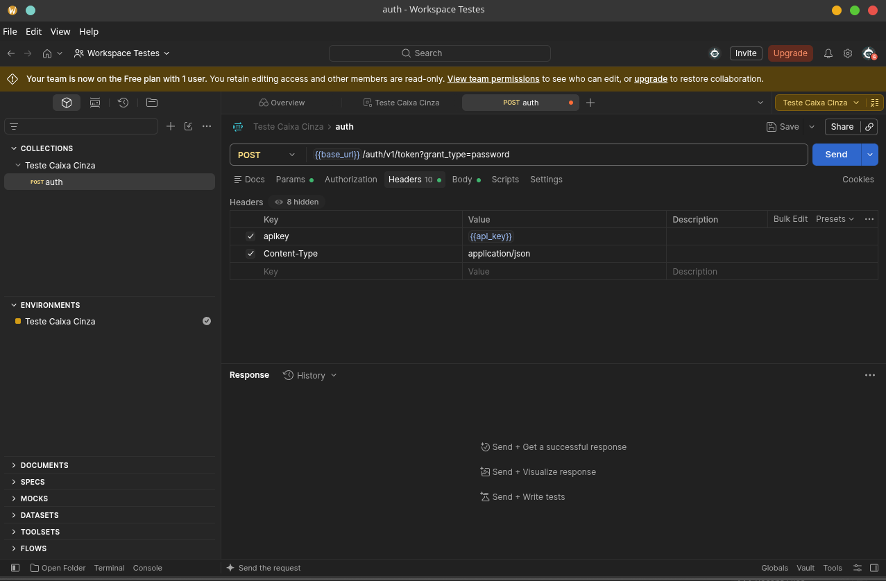

*Configuração do Body (JSON com as variáveis `{{email}}` e `{{password}}`):*

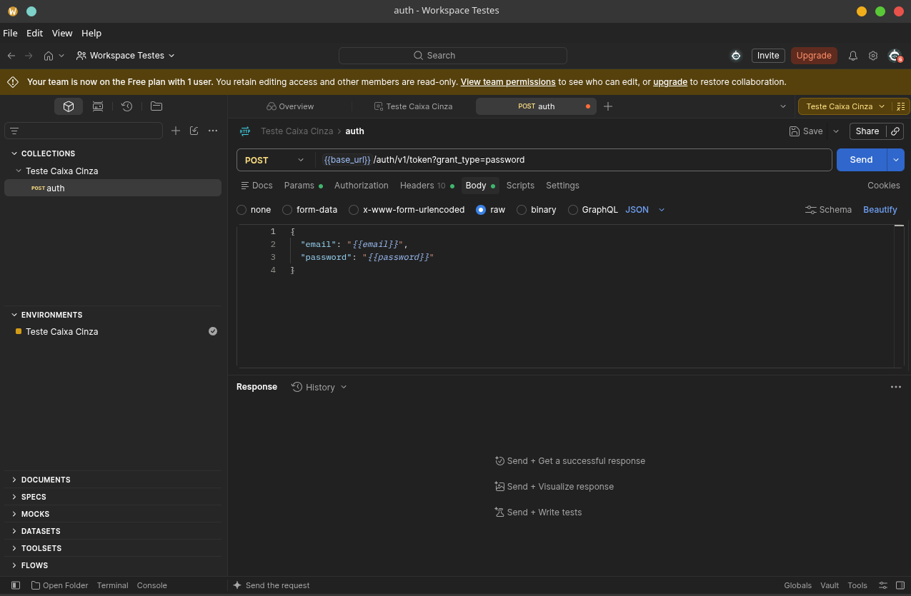

*Query Param `grant_type=password` da URL:*

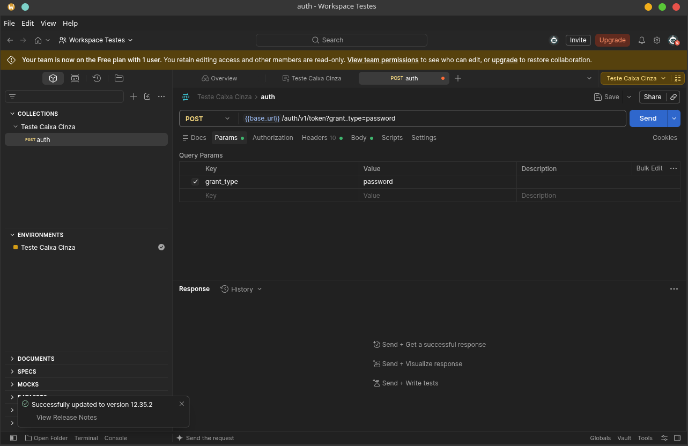

# Execução dos Testes

Foram executados os 5 cenários obrigatórios de testes de caixa cinza. As validações focaram no comportamento da API mediante entradas válidas e inválidas, analisando os códigos de status HTTP e as respostas JSON.

**Tabela de Cenários:**

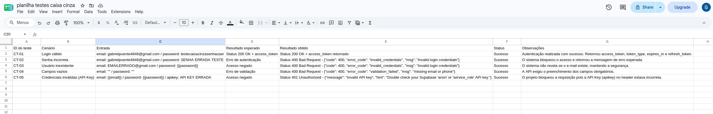

**Evidências:**

*Login Válido (Status 200 + access_token):*

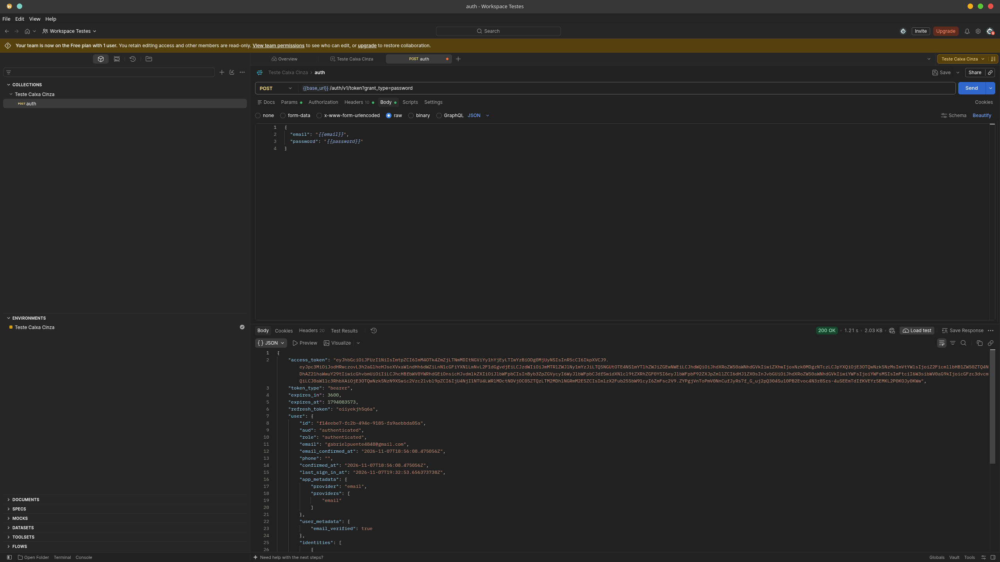

*Senha Incorreta:*

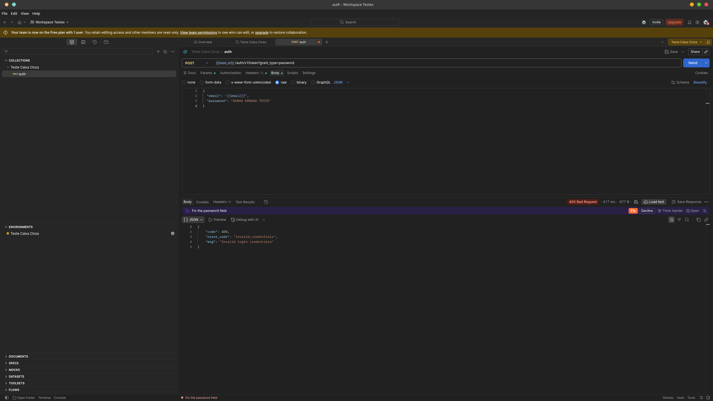

*Usuário Inexistente:*


*Campos Vazios:*


*Credenciais Inválidas (API Key errada):*

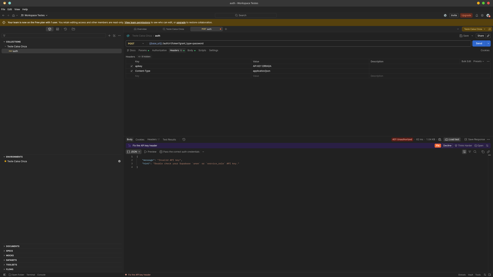

# Registro dos Testes

Os testes foram registrados em uma planilha estruturada (disponível na pasta `/planilha/`) contendo ID do teste, cenário, entradas, resultados esperados/obtidos, status e observações.

A documentação é de suma importância para a rastreabilidade, garantindo que a equipe saiba exatamente o que foi testado e o comportamento esperado da API caso haja alguma alteração futura no código. Durante os testes, não foram identificadas falhas graves na API do Supabase. O sistema se comportou conforme as boas práticas de segurança, retornando mensagens de erro genéricas tanto para senhas erradas quanto para usuários inexistentes, o que evita a enumeração de usuários maliciosos.

**Evidências:**

*Planilha preenchida:*


# Resultados Obtidos

Todos os testes executados apresentaram o comportamento esperado pela documentação da API do Supabase. A comunicação HTTP funcionou corretamente através do Postman, o envio do JSON foi aceito e as respostas (status codes 200, 400 e 401) refletiram com precisão a validade das requisições. O token JWT foi gerado e retornado corretamente no teste de login válido, comprovando que a autenticação está funcional.

# Conclusão

Os testes de caixa cinza foram executados com sucesso. A autenticação da API funcionou perfeitamente, validando a integração entre o Postman e o Supabase.

**Dificuldades encontradas:** A principal dificuldade inicial foi a correta configuração da variável `base_url`, pois é comum confundir a URL da API REST do banco de dados (que contém `/rest/v1/`) com a URL raiz necessária para o endpoint de autenticação. Após o ajuste, o fluxo ocorreu sem problemas.

**Melhorias:** Como melhoria futura, poderia ser implementada a automatização desses testes utilizando a aba "Tests" do Postman (scripts em JavaScript) para validar automaticamente o status code e a presença do token, além da criação de testes de carga e performance para a rota de login.

A importância dos testes caixa cinza em APIs é evidente, pois eles permitem que o testador valide a lógica de negócios e a segurança (conhecendo parcialmente a estrutura, como os endpoints e headers) sem a necessidade de uma interface gráfica, garantindo a robustez do backend antes de ser integrado ao frontend.
